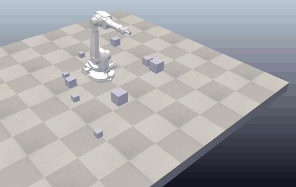

# ABB IRB 1600 — Cube-Stacking Robot Simulation (CoppeliaSim, Lua)

> 🇩🇪 Pick-and-Place-Steuerung eines 6-achsigen Industrieroboters (ABB IRB 1600) in CoppeliaSim – inverse Kinematik vollständig im Lua-Skript.

Robotics term project (EENG 428 – Introduction to Robotics, Eastern Mediterranean University, Spring 2026).

A 6-axis **ABB IRB 1600** industrial manipulator modelled in **CoppeliaSim** that automatically finds every cube in the
scene, picks them up and stacks them into a tower — with the inverse kinematics set up **entirely in script**
(no GUI IK configuration).

*The robot finds every cube, picks them up one by one and builds a tower (recording at 2× speed).*

## Features

- **Inverse kinematics in code** — `simIK` environment built from the script, solved with a
  **damped least-squares** method, so the scene needs no manual IK setup.
- **Any number of cubes** — the script auto-detects `cube1`, `cube2`, … until one is missing.
- **Different cube sizes** — each cube's own height is measured (`sim.getShapeBB`), so mixed sizes still stack cleanly;
  cubes are snapped to exact positions for a straight tower.
- **Tool stays vertical** — axes 2, 3 and 5 of the IRB 1600 are parallel, so the tool tilt is `j2 + j3 + j5`;
  the script enforces `j5 = const − j2 − j3` every step.
- **Reach checking** — reach is measured from the shoulder (axis 2), not the floor, so the model also knows how *high*
  the arm can still stack; unreachable cubes are skipped.
- **Automatic build spot** — picks a cube-free location for the tower (or a fixed one if configured).
- **Second variant: collision avoidance** — `stack_cubes_collision.lua` stores every cube as a bounding box and raises
  the travel height whenever the carried block would overlap another box on its path.

## Repository layout

| Path | Content |
|---|---|
| `scene/abb_irb1600_cube_stacking.ttt` | CoppeliaSim scene with the robot, cubes and script |
| `scripts/stack_cubes.lua` | main version — IK pick-and-place (non-threaded child script) |
| `scripts/stack_cubes_collision.lua` | variant with box-based collision avoidance (threaded child script) |
| `docs/SETUP_GUIDE.md` | step-by-step scene setup and kinematics verification |

## Run it

1. Install **CoppeliaSim EDU** (recent 4.x build).
2. Open `scene/abb_irb1600_cube_stacking.ttt` and press **Play** — the robot starts stacking.
3. To use a script in your own scene: create a `tip` dummy (child of `abb_tool`), a `target` dummy at the scene root,
   static cuboids named `cube1 … cubeN`, set all 6 joints to *Kinematic* mode, and attach the script to
   `abb_base_robot` (see `docs/SETUP_GUIDE.md`).

## Concepts covered

Forward and inverse kinematics (Denavit–Hartenberg parameters), Jacobian-based IK with damping near singularities,
workspace / reachability analysis, pick-and-place sequencing, simple geometric collision avoidance.
